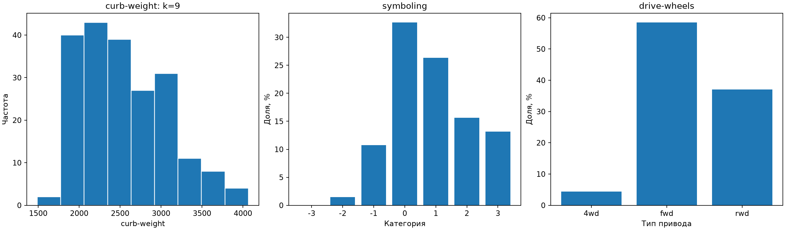
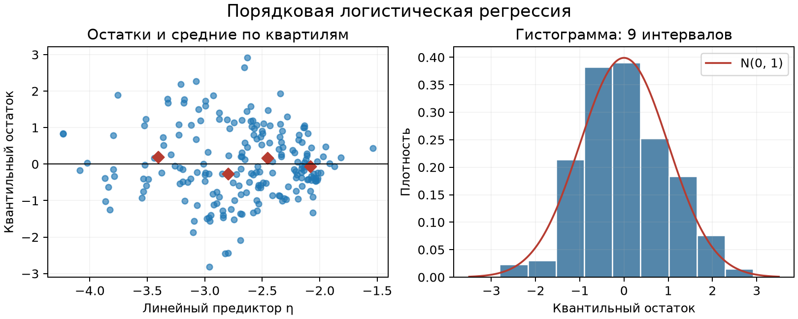

# ЛР 1.2. Регрессионный анализ — дополнительное задание

## Цель работы

Построить и сравнить две дополнительные регрессионные модели для порядковой оценки страхового риска: порядковую логистическую и порядковую пробит-регрессию. Оценить значимость коэффициентов и моделей, исследовать остатки и качество прогноза.

## 1 Описание исходных данных

В работе использован набор данных 1985 Auto Imports («Automobile»), содержащий сведения о 205 автомобилях. Для анализа выбраны три признака:

symboling – зависимая порядковая категориальная переменная, оценка страхового риска от -3 до 3; фактически наблюдаются уровни от -2 до 3.

curb-weight – независимая количественная переменная, снаряжённая масса автомобиля в фунтах.

drive-wheels – независимая номинальная переменная, тип привода: 4wd, fwd или rwd.

Таблица 1. Проверка выбранных данных

| Признак | Тип | Всего | Пропуски | Уникальных |
| --- | --- | --- | --- | --- |
| symboling | порядковый | 205 | 0 | 6 |
| drive-wheels | номинальный | 205 | 0 | 3 |
| curb-weight | количественный | 205 | 0 | 171 |

Пропуски в выбранных переменных отсутствуют, поэтому все 205 наблюдений включены в моделирование.

## 2 Результаты дескриптивного анализа

Таблица 2. Дескриптивные показатели curb-weight

| Показатель | Значение |
| --- | --- |
| Число наблюдений | 205 |
| Среднее | 2555.57 |
| Медиана | 2414 |
| Мода | 2385 |
| Минимум | 1488 |
| Максимум | 4066 |
| Размах | 2578 |
| Дисперсия | 2.711e+05 |
| Стандартное отклонение | 520.68 |

Дисперсия 271107,87 выглядит большой из-за квадратной единицы измерения (фунт²). Для интерпретации разброса удобнее стандартное отклонение 520,68 фунта: типичная масса отклоняется от среднего примерно на 521 фунт.

Таблица 3. Частоты категорий symboling

| symboling | Количество | Доля, % |
| --- | --- | --- |
| -3 | 0 | 0.00 |
| -2 | 3 | 1.46 |
| -1 | 22 | 10.73 |
| 0 | 67 | 32.68 |
| 1 | 54 | 26.34 |
| 2 | 32 | 15.61 |
| 3 | 27 | 13.17 |

Наиболее частая категория symboling – 0: 67 автомобилей, или 32,68% выборки.

Таблица 4. Частоты категорий drive-wheels

| drive-wheels | Количество | Доля, % |
| --- | --- | --- |
| 4wd | 9 | 4.39 |
| fwd | 120 | 58.54 |
| rwd | 76 | 37.07 |

В выборке преобладают автомобили с передним приводом fwd: 120 наблюдений, или 58,54%.

Рис. 1 – распределения выбранных переменных

Для curb-weight число интервалов рассчитано по формуле Стерджесса: 

k = ceil(1 + log₂(205)) = 9.

Длина интервала h = (4066 - 1488) / 9 = 286,44 фунта. Согласованность с нормальным распределением оценивается визуально. Гистограмма массы несимметрична и имеет вытянутый правый хвост, поэтому распределение curb-weight нельзя считать хорошо согласующимся с нормальным. Для категориальных symboling и drive-wheels проверка нормальности неприменима.

## 3 Регрессионные модели

Для тех же 205 автомобилей построены порядковая логистическая и порядковая пробит-регрессия. Они учитывают порядок уровней symboling: −2 < −1 < 0 < 1 < 2 < 3. Уровень −3 в выборке отсутствует. Исходных переменных по-прежнему три: оценка риска, масса и тип привода. Главы 1 и 2 сохранены без изменений.

w = curb-weight / 100;   F = I(drive-wheels = fwd);   R = I(drive-wheels = rwd)

Индикаторы F и R равны 1 для соответствующего привода и 0 в остальных случаях. Базовая категория — 4wd. Коэффициент массы относится к прибавке 100 фунтов. Параметры оцениваются максимальным правдоподобием; уровень значимости α = 0,05. Независимость записей и одинаковые коэффициенты при всех порогах приняты как предположения моделей [3–5].

Для диагностики используются квантильные остатки Данна–Смита [6], приведённые к стандартной нормальной шкале. Они подходят для категориального отклика. При верной модели их среднее должно быть близко к 0, а дисперсия — к 1. Случайная составляющая зафиксирована: seed = 12026. Гистограммы содержат 9 интервалов по формуле Стерджесса.

### 3.1 Порядковая логистическая регрессия

Модель задаёт вероятность того, что оценка риска не превышает выбранный уровень cⱼ. Здесь θⱼ — границы категорий, η — линейный предиктор, Λ — логистическая функция [3–5].

P(Y ≤ cⱼ | X) = Λ(θⱼ − η);   Λ(t) = 1 / (1 + exp(−t))

η = -0,124364w + 0,312839F + 0,825812R

Таблица 5. Коэффициенты порядковой логистической регрессии

| Параметр | Коэффициент | Ст. ошибка | z | p-value |
| --- | --- | --- | --- | --- |
| w (100 фунтов) | -0,12436 | 0,03373 | -3,687 | 0,00023 |
| I(fwd) | 0,31284 | 0,60362 | 0,518 | 0,60427 |
| I(rwd) | 0,82581 | 0,62628 | 1,319 | 0,18730 |

Таблица 6. Пороги порядковой логистической регрессии

| Уровень cⱼ | −2 | −1 | 0 | 1 | 2 |
| --- | --- | --- | --- | --- | --- |
| Порог θⱼ | -7,04633 | -4,77449 | -2,84119 | -1,64101 | -0,66071 |

Коэффициент массы значим (p = 0,00023). При прибавке 100 фунтов шансы оказаться выше любого выбранного порога умножаются на 0,8831, то есть уменьшаются примерно на 11,69% при одинаковом приводе.

Коэффициенты привода незначимы (p > 0,05). Модель в целом значима по критерию отношения правдоподобий: χ²(3) = 18,1113, p = 0,00042. Проверяется улучшение по сравнению с моделью без факторов. Значимость отдельных коэффициентов оценена z-тестами Вальда.

Среднее квантильного остатка равно 0,0083, дисперсия — 0,9625. Эти значения близки к 0 и 1. Однако отношение максимальной групповой дисперсии к минимальной по четырём группам предиктора составляет 6,50, а максимальное абсолютное среднее в группе — 0,266. Поэтому постоянство среднего и разброса остатков нельзя считать подтверждённым. Приблизительная колоколообразная форма гистограммы сама по себе не доказывает адекватность модели.

### 3.2 Порядковая пробит-регрессия

В пробит-модели используется функция стандартного нормального распределения Φ. Коэффициенты описывают изменение скрытой оценки риска в единицах стандартного отклонения скрытой ошибки. Нормальность самой symboling и массы не требуется [3–5].

P(Y ≤ cⱼ | X) = Φ(θⱼ − η)

η = -0,067907w + 0,189605F + 0,434978R

Таблица 7. Коэффициенты порядковой пробит-регрессии

| Параметр | Коэффициент | Ст. ошибка | z | p-value |
| --- | --- | --- | --- | --- |
| w (100 фунтов) | -0,06791 | 0,01975 | -3,439 | 0,00058 |
| I(fwd) | 0,18960 | 0,36720 | 0,516 | 0,60560 |
| I(rwd) | 0,43498 | 0,37789 | 1,151 | 0,24970 |

Таблица 8. Пороги порядковой пробит-регрессии

| Уровень cⱼ | −2 | −1 | 0 | 1 | 2 |
| --- | --- | --- | --- | --- | --- |
| Порог θⱼ | -3,75393 | -2,70162 | -1,57881 | -0,85259 | -0,30367 |

Коэффициент массы значим (p = 0,00058). При прибавке 100 фунтов скрытая оценка риска снижается на 0,06791 стандартного отклонения скрытой ошибки при одинаковом приводе. Это соответствует снижению вероятности высоких уровней symboling.

Коэффициенты привода незначимы (p > 0,05). Модель в целом значима по критерию отношения правдоподобий: χ²(3) = 15,2677, p = 0,00160. Проверяется улучшение по сравнению с моделью без факторов. Значимость отдельных коэффициентов оценена z-тестами Вальда.

Среднее квантильного остатка равно -0,0090, дисперсия — 0,9502. Эти значения близки к 0 и 1. Однако отношение максимальной групповой дисперсии к минимальной по четырём группам предиктора составляет 6,63, а максимальное абсолютное среднее в группе — 0,219. Поэтому постоянство среднего и разброса остатков нельзя считать подтверждённым. Приблизительная колоколообразная форма гистограммы сама по себе не доказывает адекватность модели.

## 4 Сравнительный анализ и интерпретация результатов

Таблица 9. Сравнение двух регрессионных моделей

| Показатель | Логистическая | Пробит |
| --- | --- | --- |
| AIC | 643,7038 | 646,5475 |
| Псевдо-R² Мак-Фаддена | 0,0280 | 0,0236 |
| p-value модели | 0,00042 | 0,00160 |

Обе модели статистически значимы при α = 0,05. У логистической модели меньше AIC и немного выше псевдо-R², поэтому по качеству описания этой выборки ей можно отдать предпочтение. Различие между моделями невелико. Псевдо-R² характеризует улучшение правдоподобия и не является долей объяснённой дисперсии.

Обе модели показывают одинаковую основную связь: при фиксированном приводе увеличение массы связано со снижением вероятности высоких оценок риска. Различия между типами привода после учёта массы статистически не подтверждены; для группы 4wd вывод ограничен малым числом наблюдений — 9 автомобилей.

Низкий псевдо-R² и неодинаковый разброс остатков показывают, что масса и привод описывают риск лишь частично. Результаты характеризуют статистическую связь и не доказывают причинного влияния. Качество прогноза на новых данных в этой работе не оценивалось.

## Список использованных источников

1. Методические указания «Лабораторная работа 1.2. Регрессионный анализ»: ../lab1.2/ЛР1.2.pdf.

2. Исходные данные 1985 Auto Imports и описание признаков: data/imports-85.data, data/imports-85.names.

3. McCullagh P. Regression Models for Ordinal Data. Journal of the Royal Statistical Society. Series B. 1980. Vol. 42, No. 2. P. 109–142. https://www.stat.uchicago.edu/~pmcc/pubs/paper2.pdf

4. statsmodels. OrderedModel: модель порядкового отклика. https://www.statsmodels.org/stable/generated/statsmodels.miscmodels.ordinal_model.OrderedModel.html

5. statsmodels. Ordinal Regression: примеры logit и probit. https://www.statsmodels.org/stable/examples/notebooks/generated/ordinal_regression.html

6. Dunn P. K., Smyth G. K. Randomized Quantile Residuals. Journal of Computational and Graphical Statistics. 1996. Vol. 5. P. 236–244. https://gksmyth.github.io/smyth/pubs/residual.html
