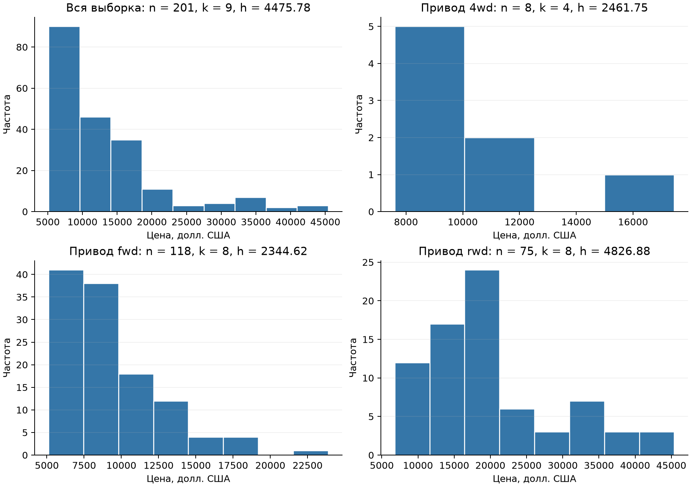
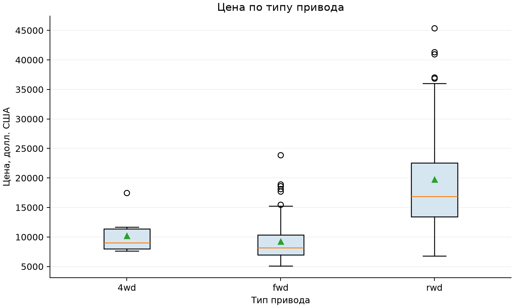
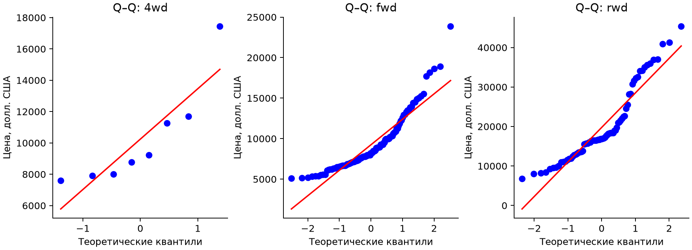
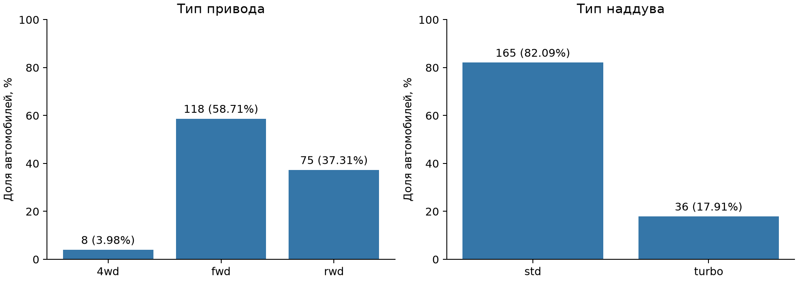
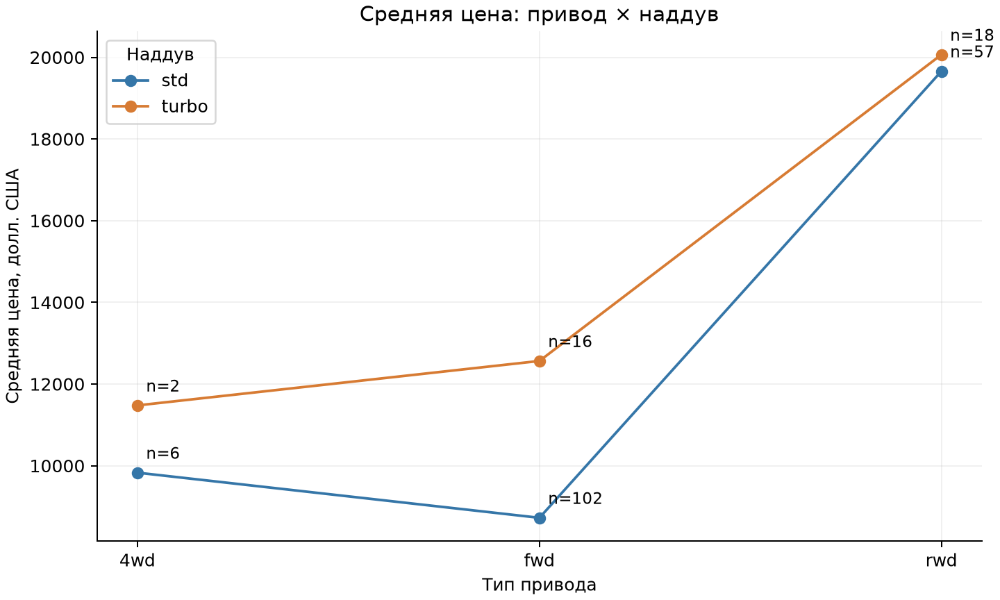

# Лабораторная работа 1.3. Дисперсионный анализ

## Оглавление

- [Цель работы](#section-01)
- [1 Описание исходных данных](#section-02)
- [2 Результаты дескриптивного анализа](#section-03)
    - [2.1 Базовые статистики цены](#section-04)
    - [2.2 Гистограммы цены и формула Стерджесса](#section-05)
    - [2.3 Оценка согласованности с нормальным распределением](#section-06)
- [3 Правила и условия применения изучаемых видов дисперсионного анализа](#section-07)
- [4 Формулировка гипотез](#section-08)
- [5 Описание градаций фактора](#section-09)
- [6 Результаты дисперсионного анализа](#section-10)
    - [6.1 Однофакторный дисперсионный анализ Фишера](#section-11)
    - [6.2 Двухфакторный дисперсионный анализ. Дополнительное задание](#section-12)
- [7 Результаты применения критерия Краскела–Уоллиса](#section-13)
- [8 Интерпретация результатов](#section-14)

## Цель работы

Изучить однофакторный дисперсионный анализ и критерий Краскела–Уоллиса на примере сравнения цен автомобилей с разными типами привода. В дополнительном задании выполнить классический двухфакторный дисперсионный анализ цены по приводу и наддуву двигателя.

## 1 Описание исходных данных

Использован набор 1985 Auto Imports («Automobile») из лабораторных работ 1.1 и 1.2. Исходный файл lab1/data/imports-85.data содержит 205 записей об автомобилях и 26 признаков. Описание данных и дескриптивные показатели рассчитаны заново для выбранной переменной price.

price — зависимая количественная переменная, цена автомобиля в долларах США. drive-wheels — независимый категориальный фактор: 4wd — полный, fwd — передний, rwd — задний привод. aspiration — второй категориальный фактор для дополнительного задания: std — стандартное исполнение без турбонаддува, turbo — турбонаддув. Этот признак выбран по техническому смыслу и наличию всех шести сочетаний его категорий с приводом.

Таблица 1. Проверка исходных данных

| Признак | Тип | Всего | Заполнено | Пропуски | В анализе |
| --- | --- | --- | --- | --- | --- |
| price | количественный | 205 | 201 | 4 | 201 |
| drive-wheels | номинальный | 205 | 205 | 0 | 201 |
| aspiration | номинальный | 205 | 205 | 0 | 201 |

Знак «?» распознаётся как пропуск. В строках 10, 45, 46, 130 отсутствует цена, поэтому эти четыре записи исключены. Цена не заполнялась средним. Во всех дальнейших расчётах используются одни и те же 201 наблюдение. Пропуски в неиспользуемых признаках не являются основанием для исключения записей.

Среда выполнения — Python: pandas и NumPy используются для обработки данных, SciPy — для статистических критериев, statsmodels — для двухфакторной модели, matplotlib — для графиков. Уровень значимости всех проверок α = 0,05.

## 2 Результаты дескриптивного анализа

### 2.1 Базовые статистики цены

Таблица 2. Базовые статистики цены в целом и по типу привода

| Показатель | Вся выборка | 4wd | fwd | rwd |
| --- | --- | --- | --- | --- |
| Число наблюдений | 201 | 8 | 118 | 75 |
| Среднее, долл. | 13 207,13 | 10 241,00 | 9 244,78 | 19 757,61 |
| Медиана, долл. | 10 295,00 | 9 005,50 | 8 192,00 | 16 900,00 |
| Минимум, долл. | 5 118 | 7 603 | 5 118 | 6 785 |
| Максимум, долл. | 45 400 | 17 450 | 23 875 | 45 400 |
| Размах, долл. | 40 282 | 9 847 | 18 757 | 38 615 |
| Дисперсия, долл.² | 63 155 863,44 | 10 812 332,00 | 11 195 035,15 | 82 493 181,86 |
| Стандартное отклонение, долл. | 7 947,07 | 3 288,21 | 3 345,90 | 9 082,58 |
| Первый квартиль, долл. | 7 775,00 | 7 984,25 | 6 950,75 | 13 455,00 |
| Третий квартиль, долл. | 16 500,00 | 11 367,75 | 10 332,50 | 22 547,50 |
| Межквартильный размах, долл. | 8 725,00 | 3 383,50 | 3 381,75 | 9 092,50 |
| Асимметрия | 1,810 | 1,780 | 1,594 | 1,027 |

Средняя цена всей выборки равна 13 207,13 долл., медиана — 10 295,00 долл. Среднее выше медианы, распределение имеет правостороннюю асимметрию. Дисперсия рассчитана с делителем n − 1 и выражена в долларах²; для интерпретации разброса удобнее стандартное отклонение в долларах. Наибольшая выборочная средняя цена наблюдается у автомобилей с задним приводом.

### 2.2 Гистограммы цены и формула Стерджесса

`k = ceil(1 + log₂(n));     h = (max(price) − min(price)) / k`

k — число интервалов с округлением вверх, h — шаг интервала. Параметры рассчитаны отдельно для всей выборки и для каждой группы по приводу. Интервалы замкнуты слева и открыты справа; последний интервал включает максимальное значение.

Таблица 3. Параметры гистограмм по формуле Стерджесса

| Выборка | n | Минимум | Максимум | k | h, долл. |
| --- | --- | --- | --- | --- | --- |
| вся выборка | 201 | 5 118 | 45 400 | 9 | 4 475,78 |
| 4wd | 8 | 7 603 | 17 450 | 4 | 2 461,75 |
| fwd | 118 | 5 118 | 23 875 | 8 | 2 344,62 |
| rwd | 75 | 6 785 | 45 400 | 8 | 4 826,88 |

Гистограммы показывают правые хвосты распределений. Для номинальных факторов привод и наддув строятся диаграммы частот, поскольку их категории не образуют числовую шкалу.

### 2.3 Оценка согласованности с нормальным распределением

Гипотезы критерия Шапиро–Уилка: H₀ — данные группы согласуются с нормальным распределением; H₁ — распределение отличается от нормального. При p < 0,05 H₀ отвергается. Для ANOVA существенны распределения внутри групп; распределение всей выборки показано дополнительно для описания данных.

Таблица 4. Проверка нормальности критерием Шапиро–Уилка

| Выборка | n | W | p-value | Вывод при α = 0,05 |
| --- | --- | --- | --- | --- |
| вся выборка | 201 | 0,7985 | 2,216e-15 | H₀ отвергается |
| 4wd | 8 | 0,7942 | 0,02477 | H₀ отвергается |
| fwd | 118 | 0,8623 | 4,388e-09 | H₀ отвергается |
| rwd | 75 | 0,8909 | 9,296e-06 | H₀ отвергается |

Во всех трёх группах p < 0,05, поэтому гипотеза нормальности отвергается. На Q–Q-графиках точки отклоняются от прямой, особенно в хвостах. Классическая ANOVA выполняется в рамках задания, а её результат сопоставляется с критерием Краскела–Уоллиса, который не требует нормальности. При интерпретации учитывается малый объём группы 4wd — 8 наблюдений.

## 3 Правила и условия применения изучаемых видов дисперсионного анализа

Однофакторный дисперсионный анализ Фишера применяется для сравнения средних количественного признака в нескольких независимых группах. В данной работе цена является числовой переменной, а тип привода задаёт три готовые категории, поэтому ANOVA соответствует постановке задачи. Её базовые предположения — независимость наблюдений, нормальность ошибок внутри групп и гомогенность, то есть равенство генеральных дисперсий. Равные размеры групп не обязательны.

Одна запись включается только в одну группу; независимость принимается как рабочее предположение. Классическая ANOVA выполняется по заданию. Поскольку в разделе 2 выявлены отклонения от нормальности, её вывод сопоставляется с критерием Краскела–Уоллиса.

Критерий Краскела–Уоллиса применяется к независимым выборкам числовых или порядковых наблюдений и не требует нормального распределения. Для приближения статистики H распределением χ² желательно не менее пяти наблюдений в каждой группе; здесь минимум равен восьми. В расчёте учитываются совпадающие ранги. При одинаковой форме распределений результат можно трактовать как различие их положения, в том числе медиан. Без этого условия вывод относится к различию распределений и рангов.

Двухфакторный дисперсионный анализ сравнивает средние с учётом двух категориальных факторов и их взаимодействия. Предположения о независимости, нормальности ошибок и гомогенности дисперсий сохраняются. Для оценки взаимодействия нужны наблюдения в сочетаниях уровней обоих факторов и остаточные степени свободы. В данном наборе все шесть сочетаний привода и наддува представлены, поэтому полная модель оценивается.

## 4 Формулировка гипотез

Для однофакторного анализа цены по типу привода проверяются гипотезы:

`H₀: μ₄wd = μfwd = μrwd;     H₁: хотя бы одно среднее отличается.`

μ — генеральная средняя цена для соответствующего типа привода. Нулевая гипотеза отвергается, если p < α = 0,05 или Fнабл > Fкрит. Альтернатива не означает, что обязательно различаются все пары групп.

Для критерия Краскела–Уоллиса H₀: распределения цены в трёх группах одинаковы; H₁: хотя бы одна группа имеет отличающееся распределение. Гипотеза отвергается при p < 0,05 или Hнабл > χ²крит с двумя степенями свободы.

Проверяются H₀A — отсутствие различий средних, связанных с приводом; H₀B — отсутствие дополнительного эффекта наддува после учёта привода; H₀AB — отсутствие взаимодействия. Соответствующие альтернативы предполагают наличие эффекта. Взаимодействие означает, что разность средних цен turbo и std зависит от типа привода. При p < 0,05 соответствующая нулевая гипотеза отвергается.

Во всех проверках α = 0,05. Если p ≥ 0,05, оснований отвергать нулевую гипотезу недостаточно; это не является доказательством равенства средних или отсутствия эффекта.

## 5 Описание градаций фактора

Основной фактор drive-wheels имеет три номинальные градации: 4wd — полный, fwd — передний, rwd — задний привод. В дополнительном задании добавлен фактор aspiration с двумя градациями: std — без турбонаддува, turbo — турбонаддув. Оба фактора уже категориальные, поэтому разбиение их значений на числовые интервалы не требуется. Число наблюдений и доли категорий рассчитаны после удаления пропусков цены.

Таблица 5. Частоты категориальных факторов

| Фактор | Категория | Число автомобилей | Доля, % |
| --- | --- | --- | --- |
| drive-wheels | 4wd | 8 | 3,98 |
| drive-wheels | fwd | 118 | 58,71 |
| drive-wheels | rwd | 75 | 37,31 |
| aspiration | std | 165 | 82,09 |
| aspiration | turbo | 36 | 17,91 |

Цены разбиты на три непересекающиеся группы по готовым категориям drive-wheels: 4wd — 8 наблюдений, fwd — 118, rwd — 75. Эти группы вместе включают все 201 наблюдение. Разбиение фактора на числовые интервалы не требуется. Полные выборки цен по группам сохранены в results/price_groups.csv.

## 6 Результаты дисперсионного анализа

### 6.1 Однофакторный дисперсионный анализ Фишера

`Q = ΣΣ(yᵢⱼ − ȳ)²;     Q1 = Σ nⱼ(ȳⱼ − ȳ)²;     Q2 = ΣΣ(yᵢⱼ − ȳⱼ)²`

`Q = Q1 + Q2`

Q — общая сумма квадратов, Q1 — межгрупповая, Q2 — внутригрупповая. ȳ — общая средняя цена, ȳⱼ — средняя цена группы j, nⱼ — размер этой группы. При N = 201 и k = 3 степени свободы равны k − 1 = 2 между группами, N − k = 198 внутри групп и N − 1 = 200 в целом.

Получено: Q1 = 5 141 171 794,58 долл.²; Q2 = 7 490 000 894,06 долл.²; Q = 12 631 172 688,64 долл.². Равенство Q = Q1 + Q2 выполнено с точностью вычислений.

`MSмеж = Q1 / (k − 1);     MSвнутр = Q2 / (N − k);     F = MSмеж / MSвнутр`

Таблица 6. Однофакторная ANOVA цены по типу привода

| Источник | SS, млн долл.² | df | MS, млн долл.² | F | p-value |
| --- | --- | --- | --- | --- | --- |
| Межгрупповая (Q1) | 5 141,1718 | 2 | 2 570,5859 | 67,9541 | 3,395e-23 |
| Внутригрупповая (Q2) | 7 490,0009 | 198 | 37,8283 | — | — |
| Общая (Q) | 12 631,1727 | 200 | — | — | — |

Fнабл = 67,9541, Fкрит(2; 198; 0,95) = 3,0415, p = 3,395e-23. Fнабл > Fкрит и p < 0,05, поэтому H₀ о равенстве всех средних цен отвергается. В выборке выявлены различия средних цен между типами привода.

`η² = Q1 / Q`

η² = 0,4070. Межгрупповые различия соответствуют 40,70% общего разброса цены в исследуемых данных. Этот показатель характеризует связь цены с приводом и не доказывает причинное влияние.

### 6.2 Двухфакторный дисперсионный анализ. Дополнительное задание

Фактор A — drive-wheels с уровнями 4wd, fwd, rwd; фактор B — aspiration с уровнями std, turbo. Зависимая переменная — price. Используются все 201 наблюдение. Все шесть сочетаний факторов присутствуют, однако размеры ячеек различаются.

Таблица 7. Цена по сочетаниям привода и наддува

| Привод | Наддув | n | Средняя, долл. | Медиана, долл. | Ст. откл., долл. |
| --- | --- | --- | --- | --- | --- |
| 4wd | std | 6 | 9 829,17 | 8 395,50 | 3 782,09 |
| 4wd | turbo | 2 | 11 476,50 | 11 476,50 | 307,59 |
| fwd | std | 102 | 8 724,03 | 7 896,50 | 2 790,44 |
| fwd | turbo | 16 | 12 564,56 | 11 663,50 | 4 614,34 |
| rwd | std | 57 | 19 660,25 | 16 515,00 | 10 009,06 |
| rwd | turbo | 18 | 20 065,94 | 18 685,00 | 5 380,22 |

`priceᵢⱼₖ = μ + Aᵢ + Bⱼ + (A × B)ᵢⱼ + εᵢⱼₖ`

μ — общий уровень цены, Aᵢ и Bⱼ — эффекты факторов, (A × B)ᵢⱼ — их взаимодействие, εᵢⱼₖ — ошибка. В Python модель задаётся формулой price ~ C(drive) * C(aspiration), где drive соответствует drive-wheels. Знак * включает оба главных эффекта и взаимодействие.

Расчёт выполняется в порядке: сначала привод, затем наддув, затем их взаимодействие. Так как размеры ячеек неодинаковы, этот порядок фиксируется. Каждый следующий эффект оценивается по добавленному им уменьшению остаточной суммы квадратов. Модель содержит 6 параметров, остаточные степени свободы равны 201 − 6 = 195. В ячейке 4wd × turbo всего 2 наблюдения, что ограничивает точность выводов по этой комбинации.

Таблица 8. Классическая двухфакторная ANOVA для цены

| Эффект | SS, млн долл.² | df | MS, млн долл.² | F | p-value |
| --- | --- | --- | --- | --- | --- |
| Привод A | 5 141,1718 | 2 | 2 570,5859 | 68,8580 | 2,378e-23 |
| Наддув B | 128,8427 | 1 | 128,8427 | 3,4513 | 0,06471 |
| Взаимодействие A × B | 81,4753 | 2 | 40,7376 | 1,0912 | 0,33784 |
| Остаток | 7 279,6829 | 195 | 37,3317 | — | — |

Привод: F(2; 195) = 68,8580, p = 2,378e-23 < 0,05. H₀A отвергается — тип привода связан с различиями средней цены.

Наддув после учёта привода: F(1; 195) = 3,4513, p = 0,06471 > 0,05. H₀B не отвергается — дополнительное различие средних цен по наддуву статистически не подтверждено.

Взаимодействие: F(2; 195) = 1,0912, p = 0,33784 > 0,05. H₀AB не отвергается — статистических оснований считать, что различие цен turbo и std зависит от привода, недостаточно. Неотклонение H₀ не доказывает полного отсутствия эффекта.

По горизонтали указан тип привода, по вертикали — средняя цена. Линии соответствуют std и turbo; рядом с точками приведены размеры ячеек. Линии не полностью параллельны, однако графическое различие само по себе не доказывает взаимодействия. По F-проверке взаимодействие при α = 0,05 не подтверждено.

## 7 Результаты применения критерия Краскела–Уоллиса

Для проверки сформулированной в разделе 4 гипотезы все 201 значение цены ранжируются совместно от меньшей цены к большей; совпадающим ценам присваиваются средние ранги. Далее рассчитываются суммы и средние ранги по группам.

Таблица 9. Суммы и средние ранги цены по группам

| Тип привода | n | Сумма рангов | Средний ранг |
| --- | --- | --- | --- |
| 4wd | 8 | 707,5 | 88,438 |
| fwd | 118 | 8 185,0 | 69,364 |
| rwd | 75 | 11 408,5 | 152,113 |

`H* = [12 / (N(N + 1))] Σ(Rⱼ² / nⱼ) − 3(N + 1)`

`C = 1 − Σ(t³ − t) / (N³ − N);     H = H* / C`

Rⱼ — сумма рангов группы, t — число наблюдений с одной и той же ценой, C — поправка на совпадающие ранги. При N = 201, k = 3 статистика H сравнивается с распределением χ² с k − 1 = 2 степенями свободы.

Таблица 10. Критерий Краскела–Уоллиса с поправкой на совпадения

| H* | C | H | df | χ²крит | p-value |
| --- | --- | --- | --- | --- | --- |
| 93,1879 | 0,999989 | 93,1889 | 2 | 5,9915 | 5,811e-21 |

H = 93,1889 > χ²крит = 5,9915, p = 5,811e-21 < 0,05. Нулевая гипотеза отвергается: распределения цены по типам привода различаются. У rwd наибольший средний ранг, что соответствует более высоким ценам в этой группе. Критерий проверяет различия распределений; интерпретация как проверки только медиан требует одинаковой формы распределений.

## 8 Интерпретация результатов

1. Для цены автомобиля выполнен новый дескриптивный анализ. После удаления четырёх пропусков исследуются 201 наблюдение. Построены гистограммы с интервалами по формуле Стерджесса, рассчитаны характеристики всей выборки и групп по приводу.

2. Критерий Шапиро–Уилка и Q–Q-графики показывают отклонения от нормальности во всех трёх группах. Поэтому результат классической ANOVA интерпретируется с учётом её предпосылок и сопоставляется с ранговым критерием Краскела–Уоллиса.

3. Однофакторная ANOVA отвергает гипотезу равенства всех средних цен: F = 67,9541, p = 3,395e-23. η² = 0,4070: межгрупповые различия составляют 40,70% общего разброса цены.

4. Критерий Краскела–Уоллиса также обнаруживает различия распределений: H = 93,1889, p = 5,811e-21. Средние цены в выборке: 4wd — 10 241,00 долл., fwd — 9 244,78 долл., rwd — 19 757,61 долл. Наибольшая выборочная средняя цена и наибольший средний ранг наблюдаются у rwd. Общие критерии не устанавливают значимость каждой отдельной пары групп.

5. В классической двухфакторной модели привод значим. Дополнительный эффект наддува после учёта привода и взаимодействие факторов при α = 0,05 не подтверждены. Выводы ограничены несбалансированными размерами ячеек и малой группой 4wd × turbo.

6. Полученные результаты описывают связи в историческом наборе Automobile. Они не доказывают причинного влияния привода или наддува на цену: марки, мощность и класс автомобилей в анализе не контролировались.
