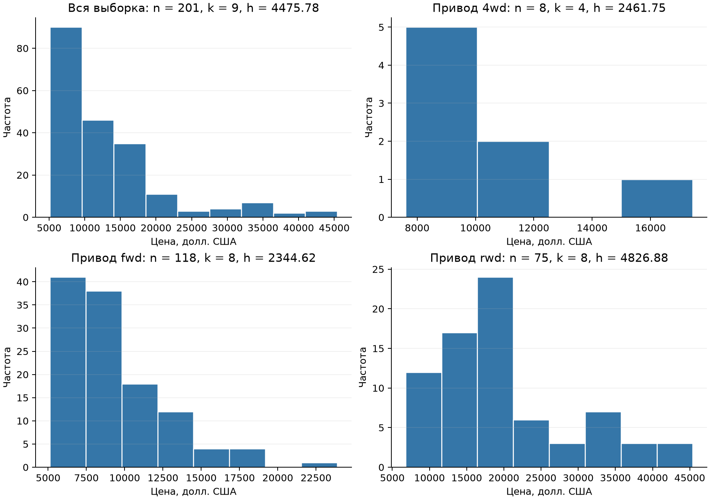
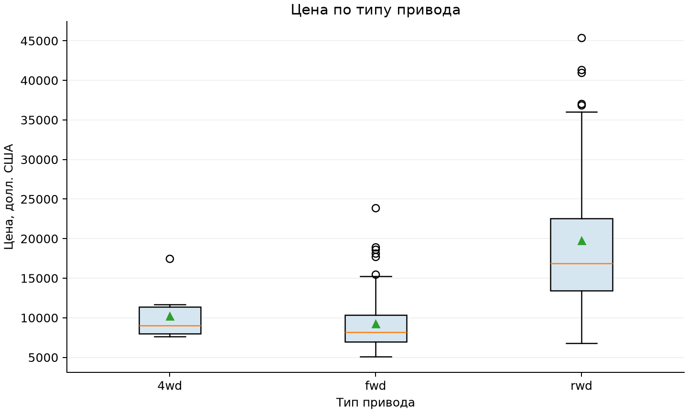
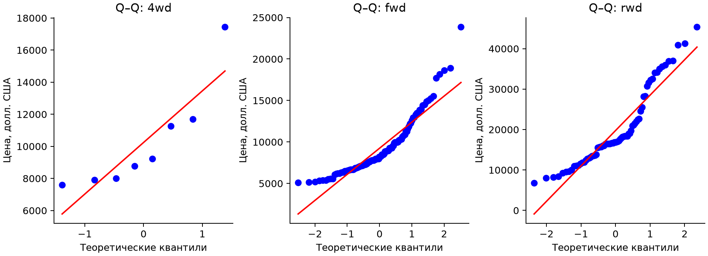

# ЛР 1.3. Дисперсионный анализ – дополнительное задание

## Цель работы

Применить два дополнительных метода дисперсионного анализа – ANOVA Уэлча и ANOVA Брауна–Форсайта – для сравнения средних цен автомобилей с разными типами привода при неодинаковых дисперсиях. Сопоставить результаты и дать их интерпретацию.

## 1 Описание исходных данных

Использован тот же набор 1985 Auto Imports («Automobile»), что и в основной лабораторной работе 1.3. Файл imports-85.data содержит 205 записей об автомобилях и 26 признаков. Для обоих дополнительных методов достаточно двух переменных.

price – зависимая количественная переменная, цена автомобиля в долларах США. drive-wheels – независимый категориальный фактор: 4wd – полный привод, fwd – передний, rwd – задний. Переменная aspiration в этом дополнении не используется. Интервальное разбиение фактора не требуется: его градации заданы в исходном наборе.

Таблица 1. Проверка исходных данных

| Признак | Тип | Всего | Заполнено | Пропуски | В анализе |
| --- | --- | --- | --- | --- | --- |
| price | количественный | 205 | 201 | 4 | 201 |
| drive-wheels | номинальный | 205 | 205 | 0 | 201 |

Цена отсутствует в строках 10, 45, 46 и 130 исходного файла. Эти четыре записи исключены без заполнения пропусков. В обоих методах используются одинаковые 201 наблюдение: 4wd – 8, fwd – 118, rwd – 75. Расчёты выполнены в Python с библиотеками NumPy, pandas, SciPy и statsmodels. Уровень значимости α = 0,05.

## 2 Результаты дескриптивного анализа

### 2.1 Базовые статистики цены

Таблица 2. Базовые статистики цены в целом и по типу привода

| Показатель | Вся выборка | 4wd | fwd | rwd |
| --- | --- | --- | --- | --- |
| Число наблюдений | 201 | 8 | 118 | 75 |
| Среднее, долл. | 13 207,13 | 10 241,00 | 9 244,78 | 19 757,61 |
| Медиана, долл. | 10 295,00 | 9 005,50 | 8 192,00 | 16 900,00 |
| Минимум, долл. | 5 118 | 7 603 | 5 118 | 6 785 |
| Максимум, долл. | 45 400 | 17 450 | 23 875 | 45 400 |
| Размах, долл. | 40 282 | 9 847 | 18 757 | 38 615 |
| Дисперсия, долл.² | 63 155 863,44 | 10 812 332,00 | 11 195 035,15 | 82 493 181,86 |
| Стандартное отклонение, долл. | 7 947,07 | 3 288,21 | 3 345,90 | 9 082,58 |
| Первый квартиль, долл. | 7 775,00 | 7 984,25 | 6 950,75 | 13 455,00 |
| Третий квартиль, долл. | 16 500,00 | 11 367,75 | 10 332,50 | 22 547,50 |
| Межквартильный размах, долл. | 8 725,00 | 3 383,50 | 3 381,75 | 9 092,50 |
| Асимметрия | 1,810 | 1,780 | 1,594 | 1,027 |

Средняя цена равна 13 207,13 долл., медиана – 10 295,00 долл. Превышение среднего над медианой соответствует правосторонней асимметрии. Наибольшие выборочные средняя цена и разброс наблюдаются у rwd. Дисперсии и стандартные отклонения рассчитаны с делителем n − 1. Эти показатели совпадают с основным отчётом, поскольку отклик и выборка сохранены.

### 2.2 Гистограммы цены и формула Стерджесса

k = ceil(1 + log₂(n));     h = (max(price) − min(price)) / k

Число интервалов k округляется вверх; h – длина интервала. Параметры определены отдельно для всей выборки и каждого привода. Последний интервал включает максимум.

Таблица 3. Параметры гистограмм по формуле Стерджесса

| Выборка | n | Минимум | Максимум | k | h, долл. |
| --- | --- | --- | --- | --- | --- |
| вся выборка | 201 | 5 118 | 45 400 | 9 | 4 475,78 |
| 4wd | 8 | 7 603 | 17 450 | 4 | 2 461,75 |
| fwd | 118 | 5 118 | 23 875 | 8 | 2 344,62 |
| rwd | 75 | 6 785 | 45 400 | 8 | 4 826,88 |

Распределения имеют правые хвосты. Диаграмма размаха показывает различия положения и разброса групп; высокие цены сохранены как часть исходных данных.

### 2.3 Проверка предпосылок

Критерий Шапиро–Уилка проверяет согласованность распределения цены с нормальным. Для дисперсионного анализа существенны отдельные группы; вся выборка показана дополнительно. При p < 0,05 гипотеза нормальности отвергается.

Таблица 4. Проверка нормальности критерием Шапиро–Уилка

| Выборка | n | W | p-value | Вывод при α = 0,05 |
| --- | --- | --- | --- | --- |
| вся выборка | 201 | 0,7985 | 2,216e-15 | H₀ отвергается |
| 4wd | 8 | 0,7942 | 0,02477 | H₀ отвергается |
| fwd | 118 | 0,8623 | 4,388e-09 | H₀ отвергается |
| rwd | 75 | 0,8909 | 9,296e-06 | H₀ отвергается |

Во всех трёх группах нормальность отвергается. Равенство дисперсий проверено критерием Левена с центром в медиане: F(2; 198) = 18,4887, p = 4,348e-08. Гипотеза равенства дисперсий также отвергается. Поэтому выбраны методы, допускающие неодинаковые дисперсии. Они не устраняют ограничения, связанные с асимметрией и малой группой 4wd.

## 3 Дисперсионные модели

Применяются два отсутствующих в основном отчёте варианта однофакторного анализа: ANOVA Уэлча и ANOVA Брауна–Форсайта. Они проверяют равенство средних цен трёх независимых групп, допуская разные групповые дисперсии. Оба метода используют исходную шкалу цены; преобразования и новые признаки не вводятся [3, 4].

Yᵢⱼ = μᵢ + εᵢⱼ;     E(εᵢⱼ) = 0;     Var(εᵢⱼ) = σᵢ²

Здесь i – группа привода, j – автомобиль, μᵢ – средняя цена соответствующей группы. Независимость записей принята как рабочее предположение; близкие модели одной марки могут быть похожи. F-приближения предполагают нормальность либо достаточно большие выборки, поэтому выявленные отклонения от нормальности учитываются при выводах.

H₀: μ₄wd = μfwd = μrwd;     H₁: хотя бы одна средняя отличается

Правило решения общее для обоих методов: если p < 0,05, H₀ отвергается. Общая проверка не устанавливает значимость каждой отдельной пары групп.

### 3.1 Дисперсионный анализ Уэлча

Метод Уэлча учитывает неодинаковую точность групповых средних: каждой группе назначается вес wᵢ = nᵢ/sᵢ², где nᵢ – объём группы, sᵢ² – выборочная дисперсия. Взвешенное среднее и поправка к F-статистике учитывают различия дисперсий и объёмов [3, 4].

x̄w = Σwᵢx̄ᵢ / Σwᵢ;     T = Σ[(1 − wᵢ/Σwᵢ)²/(nᵢ − 1)]

F_W = [Σwᵢ(x̄ᵢ − x̄w)² / (k − 1)] / [1 + 2(k − 2)T/(k² − 1)]

В этой работе k = 3; степени свободы равны ν₁ = k − 1 и ν₂ = (k² − 1)/(3T).

Таблица 5. Результат ANOVA Уэлча

| F | ν₁ | ν₂ | p-value |
| --- | --- | --- | --- |
| 44,7198 | 2 | 19,3559 | 5,540e-08 |

p = 5,540e-08 < 0,05: гипотеза равенства всех средних цен отвергается. Различия сохраняются при учёте неодинаковых групповых дисперсий.

### 3.2 Дисперсионный анализ Брауна–Форсайта

ANOVA Брауна–Форсайта также сравнивает средние при неодинаковых дисперсиях, но использует другую поправку к внутригрупповому разбросу. В этом разделе проверяется равенство средних цен. Числитель F-статистики описывает различия групповых средних относительно общего среднего x̄ [3, 4].

F_BF = Σnᵢ(x̄ᵢ − x̄)² / Σ[(1 − nᵢ/N)sᵢ²];     N = 201

Использована поправка Мехротры к степеням свободы, реализованная в statsmodels при use_var='bf'. Поэтому обе степени свободы могут быть дробными [3].

Таблица 6. Результат ANOVA Брауна–Форсайта с поправкой Мехротры

| F | ν₁ | ν₂ | p-value |
| --- | --- | --- | --- |
| 77,0594 | 1,3738 | 86,0663 | 2,862e-16 |

p = 2,862e-16 < 0,05: гипотеза равенства всех средних цен отвергается. Результат согласуется с ANOVA Уэлча.

## 4 Сравнительный анализ и интерпретация результатов

Оба дополнительных метода приводят к одному выводу: не все средние цены автомобилей с разными типами привода равны. Значения F и p различаются из-за разных способов учёта неодинаковых дисперсий. Меньшее p-value само по себе не означает, что метод лучше.

В выборке средняя цена rwd составляет 19 757,61 долл., 4wd – 10 241,00 долл., fwd – 9 244,78 долл. У rwd наблюдается наибольшая средняя цена; значимость каждой пары отдельно не проверялась. Согласие двух методов поддерживает общий вывод о различиях средних при неодинаковых дисперсиях.

Выводы ограничены асимметрией распределений, восемью автомобилями в группе 4wd и наблюдательным характером данных. Анализ описывает связь привода с ценой и не доказывает причинного влияния: марка и другие характеристики не учитывались.

### Источники

1. Методические указания «Лабораторная работа 1.3. Дисперсионный анализ»: ../lab1.3/ЛР1.3.pdf.

2. 1985 Auto Imports: data/imports-85.data; описание признаков – data/imports-85.names.

3. statsmodels. anova_oneway: ANOVA Уэлча и Брауна–Форсайта. https://www.statsmodels.org/stable/generated/statsmodels.stats.oneway.anova_oneway.html

4. Dag O., Dolgun A., Konar N. M. onewaytests: An R Package for One-Way Tests in Independent Groups Designs. The R Journal. 2018. https://journal.r-project.org/articles/RJ-2018-022/index.html
